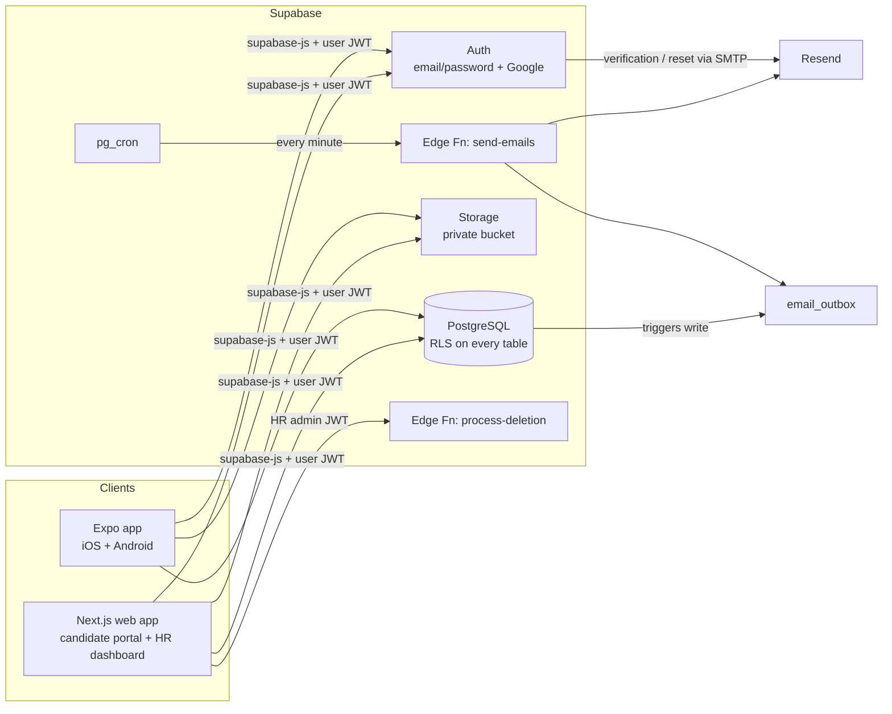

# Architecture: HR Recruitment & Applicant Management Platform

## 1. System overview



One Supabase project is the single backend for the website and both mobile apps, so data is always in sync. There is no separate API server to host or secure: clients call Postgres directly through PostgREST, and **Row-Level Security in the database is the authorization layer**. Operations that need multi-step business rules (submitting an application, replacing a document) are Postgres functions (RPCs) that run atomically.

## 2. Technology choices

| Layer | Choice | Why |
|---|---|---|
| Web | Next.js (App Router) + TypeScript, Tailwind, shadcn/ui | SSR for auth-aware pages, mature ecosystem, deploys to Vercel in minutes |
| HR tables / Kanban | TanStack Table, dnd-kit | Server-side filtering at scale; accessible drag-and-drop (keyboard support) |
| Mobile | Expo (React Native) + Expo Router | One codebase for iOS + Android, OTA updates, EAS cloud builds (no Mac needed for iOS builds) |
| Shared code | `@hr/shared` (Zod schemas, statuses, upload rules) | Identical validation on web and mobile |
| Backend | Supabase: Postgres, Auth, Storage, Edge Functions | Matches your preference; RLS gives database-enforced security |
| Email | Resend (transactional) + Resend SMTP for Auth emails | Simple API, good deliverability, one provider for everything |
| Hosting | Vercel (web), Supabase Cloud (EU region), EAS → App Store / Play Store | Managed, scalable, GDPR-friendly region choice |

I kept your proposed stack. The one deliberate addition is the **email outbox** pattern: database triggers queue emails in the same transaction as the change that caused them, and a worker delivers them with retries. An email can never be lost because a request crashed, and a failed send never rolls back a status change.

## 3. Data model

| Table | Purpose |
|---|---|
| `profiles` | 1:1 with `auth.users`; name, contact details, `role` (candidate / hr_viewer / hr_recruiter / hr_admin), HR notification preferences |
| `positions` | Job positions: title, department, location, type, description, deadline, open/closed, active flag |
| `applications` | One per candidate per position (or "Other" with free-text title). Snapshot of personal info, additional info, consents with policy version + timestamp, status, human reference (`APP-001001`) |
| `documents` | Metadata for CV / cover letter / additional files; replaced versions are kept (`replaced_at`) |
| `application_status_history` | Every status transition with who and when |
| `application_notes` | Internal HR notes: **no candidate policy exists, so they are invisible to candidates at the database level** |
| `interviews` | Scheduled interviews (time, duration, mode, location / link, candidate-facing details) |
| `notifications` | In-app notifications for the candidate dashboard and mobile app (Realtime-enabled) |
| `email_outbox` | Queued transactional emails (service-role only) |
| `deletion_requests` | GDPR erasure requests and their outcome |
| `audit_log` | Document access, role changes, erasures (admin-only) |

## 4. Security model

**Roles.** `candidate` (default for every sign-up), `hr_viewer` (read-only), `hr_recruiter` (manage applications, notes, interviews), `hr_admin` (everything, plus positions, staff roles, GDPR requests). Roles live in `profiles.role`; a trigger blocks anyone except an HR admin from changing a role, and no one can change their own.

**Enforced in the database, not the UI:**
- Candidates can read only their own profile, applications, documents, status history, interviews and notifications.
- Candidates cannot insert applications directly; `submit_application()` validates the position is open, prevents duplicates, requires both consents and exactly one CV and one cover letter, and verifies each uploaded file exists in **their own** storage folder. File size and type are read from Storage metadata, not trusted from the client.
- HR can change only an application's `status`; candidate-submitted data is immutable.
- Unverified email addresses cannot submit applications.
- Files live in a private bucket at `{user_id}/{uuid}.ext`. Storage policies let a user upload only into their own folder; reads are owner-or-HR; files are served via short-lived signed URLs. The bucket rejects anything other than PDF/DOC/DOCX or over 10 MB.
- Service-only tables (`email_outbox`) have no API grants; worker RPCs are executable only by `service_role`.

These guarantees are verified by `supabase/tests/security_test.sql` (78 checks).

**GDPR.** Explicit, versioned consent captured per application; candidates can request erasure from their dashboard or the app; an HR admin approves it and `process-deletion` removes every stored file and the auth user, which cascades through all personal data. The daily `maintenance` function deletes abandoned uploads, deletes rejected applications (with files) 12 months after the decision, and prunes operational logs. Choose an EU region for the Supabase project.

**Abuse limits and browser hardening.** Database triggers cap applications (5/day), document changes (40/day) and uploads (60/day) per candidate; Supabase Auth rate-limits sign-ups, sign-ins and emails. The website sends a nonce-based Content Security Policy (only its own scripts run; data goes only to the site and Supabase) plus HSTS, frame and referrer headers.

## 5. Key flows

**Registration.** Email sign-up → Supabase sends a verification email (branded template via Resend SMTP) → on verification, a trigger creates the welcome email and the HR "new registration" email. Google sign-in arrives pre-verified and gets the same emails immediately.

**Application.** Form validated client-side with the shared Zod schema → files uploaded straight to Storage → `submit_application()` creates the application and attaches documents in one transaction → triggers write the status history row, the in-app notification and the two emails.

**Status change / Kanban.** HR drags a card → a single `update applications set status = …` → triggers record history, notify the candidate in-app (live via Realtime) and queue the email. Scheduling an interview moves the application to *Interview Scheduled* automatically and sends one detailed interview email instead of a generic status email.

## 6. Repository layout

```
hr-recruit/
├── apps/
│   ├── web/              Next.js: candidate portal + /hr dashboard        (Stages 2–4)
│   └── mobile/           Expo: iOS + Android                              (Stage 5)
├── packages/shared/      Zod schemas, statuses, upload rules, error mapping
├── supabase/
│   ├── migrations/       Schema, functions & triggers, RLS, storage
│   ├── functions/        send-emails, maintenance, process-deletion (+ shared templates)
│   ├── templates/        Branded auth emails (verify, reset)
│   ├── tests/            Security & workflow test suite
│   ├── sql/              One-time setup scripts (scheduled jobs, first admin)
│   ├── seed.sql          Sample positions
│   └── config.toml       Local Supabase config
├── tests/                End-to-end suites + local test backend (CI runs them)
└── docs/                 Architecture and deployment guide
```

## 7. Delivery plan

| Stage | Scope | Status |
|---|---|---|
| 1 | Architecture, database, RLS, storage, triggers, email worker, GDPR function, shared package, tests | **Done** |
| 2 | Web app foundation: design system, auth (register, login, Google, verify, forgot/reset, logout), route protection | **Done** |
| 3 | Candidate portal: job list, multi-step application form with uploads, dashboard, progress tracker, notifications, profile, document replacement, deletion request | **Done** |
| 4 | HR dashboard: overview stats & charts, applications table (search, filters, pagination), candidate profile, document download, notes, status changes, history, Kanban pipeline, interview scheduling, positions management, staff roles, GDPR queue | **Done** |
| 5 | Mobile app (Expo): candidate experience in full; HR essentials (overview, applications list, candidate detail, status change, notes; a stage picker replaces drag-and-drop on phones) | **Done** |
| 6 | Hardening & launch: abuse limits, daily maintenance (abandoned uploads, retention, log pruning), Content Security Policy, portable test backend + CI running every suite, production deployment guide | **Done** |
